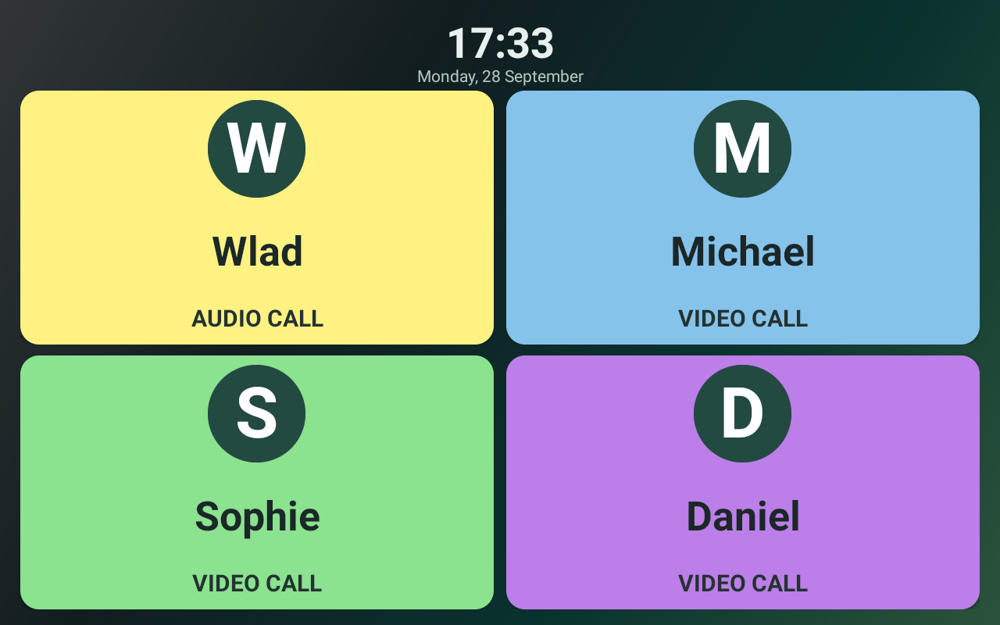
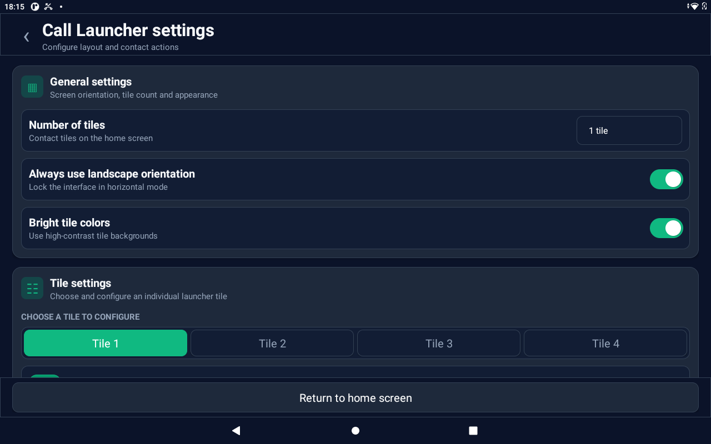
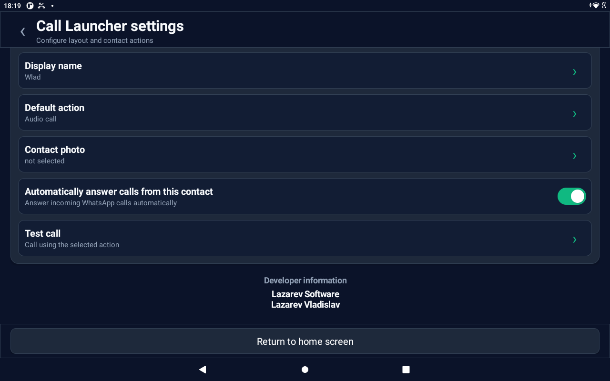

<div align="center">

# 📞 Call Launcher

### A simple, accessible Android launcher for fast WhatsApp calls

[](https://www.android.com/)
[](https://kotlinlang.org/)
[](#)
[](https://www.whatsapp.com/)

**Large contact tiles · One-tap calls · Per-contact auto-answer · English and Russian**

</div>

---

## ✨ About the project

**Call Launcher** is an accessible Android home screen designed for seniors and anyone who prefers a simpler calling experience. It replaces a busy launcher with large, readable contact tiles that can start WhatsApp audio or video calls with a single tap.

The interface is intentionally calm, high-contrast and easy to navigate on a tablet.

## 🖼️ Screenshots

### Launcher

<p align="center">
  
</p>

### Settings

<table>
  <tr>
    <td width="50%" align="center"><strong>General settings</strong></td>
    <td width="50%" align="center"><strong>Contact and call settings</strong></td>
  </tr>
  <tr>
    <td></td>
    <td></td>
  </tr>
</table>

## 🚀 Features

### 👥 Accessible contact tiles

- Display from **1 to 4 contacts** on the home screen.
- Use an individual name and photo for every tile.
- Show one large tile, a horizontal row, or a responsive 2 × 2 grid.
- Choose between calm colors and bright high-contrast colors.

### 📱 WhatsApp calling

- Start an **audio call** or **video call** with one tap.
- Select the default action independently for each contact.
- Pick contacts directly from WhatsApp.
- Test the configured call action from the settings screen.

### ☎️ Per-contact auto-answer

- Enable or disable automatic answering for each tile separately.
- Calls from contacts without auto-answer enabled remain unanswered.
- The feature uses an Android Accessibility Service and can be switched off at any time.

### 🎨 Senior-friendly interface

- Large fonts and controls.
- High contrast and clear visual hierarchy.
- Optional landscape-only mode for tablets.
- Dark, modern settings interface with bright emerald accents.
- Hidden settings access prevents accidental configuration changes.

### 🌍 Languages

- 🇬🇧 English
- 🇷🇺 Russian

## 🧭 Layout options

| Tiles | Home-screen layout |
|:---:|---|
| **1** | One full-size contact tile |
| **2** | Two large horizontal tiles |
| **3** | Three horizontal tiles |
| **4** | Four tiles in a 2 × 2 grid |

## 🛠️ Build and install

Download the ready-to-install APK from [GitHub Releases](https://github.com/lazarev-lab/call-launcher/releases).

### Requirements

- Android Studio with Android SDK 35
- JDK 17 or newer
- Android 6.0 or newer device
- WhatsApp installed on the target device

### Build with Android Studio

1. Clone or download the project.
2. Open the project folder in **Android Studio**.
3. Allow Gradle to synchronize the project.
4. Select **Build → Build APK(s)**.
5. Install the generated debug APK from `app/build/outputs/apk/debug/`.

### Install with ADB

```bash
adb install -r app/build/outputs/apk/debug/app-debug.apk
```

## ⚙️ Initial setup

1. Open Call Launcher and grant the requested contact and calling permissions.
2. Set **Call Launcher** as the default Home application.
3. Open the hidden settings screen by tapping the clock five times.
4. Choose the number of tiles and configure each contact.
5. If auto-answer is needed, enable the **Call Launcher auto-answer** service in Android Accessibility settings.

> [!IMPORTANT]
> WhatsApp and Android interfaces may differ between device models and app versions. Verify auto-answer behavior on the target device before relying on it.

## 🔐 Privacy

- Configuration is stored locally on the device.
- The application does not use its own server or analytics service.
- Contact permissions are used to prepare WhatsApp calling endpoints.
- The Accessibility Service is used only for the optional incoming-call auto-answer workflow.

## 🧱 Technology

- **Kotlin 2.0.21**
- **Android Gradle Plugin 8.7.0**
- **Minimum SDK 23**
- **Target SDK 35**
- Native Android views with no web-based runtime

## 👨‍💻 Developer

**Lazarev Software**  
**Vladislav Lazarev**

---

<div align="center">

### Built to make everyday communication simpler 💚

</div>
